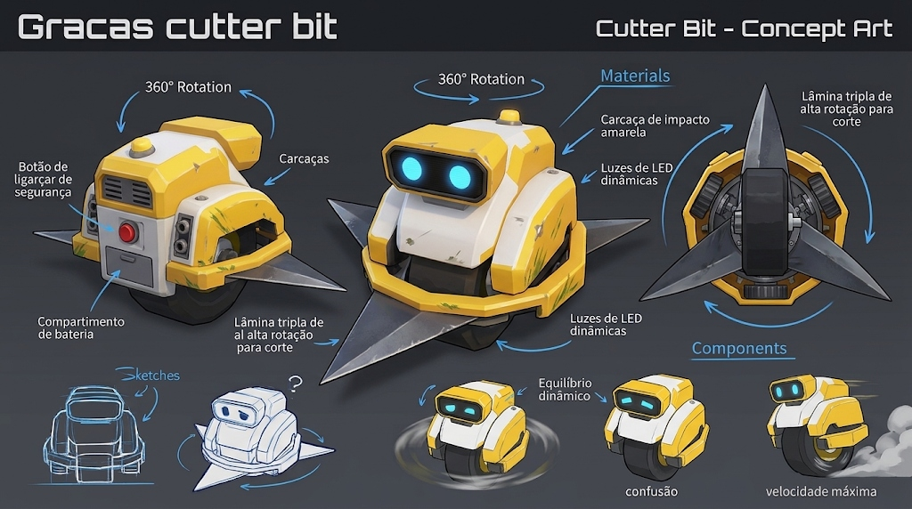

# Direção de Arte e Estilo Visual: Grass Cut Bot 🎨🌿

Este documento estabelece as diretrizes estéticas canônicas para o projeto **Grass Cut Bot**, com foco na entrega do estilo *Low Poly fosco vibrante* e na sensação de relaxamento visual (*satisfying aesthetics*).

---

## 1. Princípios Estéticos Fundamentais

1. **Low Poly com Cores Sólidas (Flat / Matte Shading):**
   - As superfícies não utilizam texturas fotorealistas ruidosas.
   - O acabamento é puramente fosco (`roughness = 0.85 ~ 0.95`), eliminando reflexos especulares plásticos desagradáveis.
   - As formas geométricas priorizam arestas limpas, silhuetas legíveis em telas pequenas de smartphone e volumes fáceis de ler de relance.

2. **Cores Saturadas e Harmoniosas (Arcade Warm Palette):**
   - A paleta equilibra tons naturais de vegetação com contrastes acentuados entre elementos colhíveis, piso limpo e obstáculos perigosos.

---

## 2. Paleta de Cores Canônica

*Figura: Concept Art canônico do robô cortador (Cutter Bit) demonstrando a aplicação dos materiais foscos, cores da carcaça amarela, placas brancas, lâmina de aço e sensores ciano emissivos.*

| Elemento | Código HEX | Amostra | Função no Jogo |
| :--- | :--- | :--- | :--- |
| **Grama Alta (Intacta)** | `#43A047` / `#4CAF50` | 🟢 Verde Esmeralda | Alvo principal comum de corte. |
| **Piso Aparado (Cortado)** | `#2E6930` / `#1B5E20` | 🟩 Verde Profundo | Revelado após a passagem da serra (sensação de gramado limpo). |
| **Trigo Maduro** | `#FBC02D` / `#FFB300` | 🟡 Dourado Quente | Alvo especial com maior valor e resistência. |
| **Flores do Campo** | `#E91E63` / `#AB47BC` | 🌸 Magenta Vibrante | Alvo raro/valioso com pétalas coloridas. |
| **Carcaça do Robô** | `#F5A623` / `#F7A81B` | 🟨 Amarelo Industrial | Carcaça externa em ABS/Policarbonato (cabeça, paralamas, deck). |
| **Blindagem e Estrutura** | `#E8ECEF` / `#F0F3F6` | ⚪ Branco Metal | Placas protetoras superiores parafusadas e estrutura central. |
| **Pneu Mono-Wheel & Viseira** | `#141416` / `#0D0E10` | ⬛ Preto Profundo | Pneu com cravos, máscara frontal dos olhos, grelhas e calha da serra. |
| **Lâminas e Pistões** | `#CBD3DC` / `#B0BEC5` | ⚙️ Aço Temperado | Disco rotor de alta rotação e hastes dos pistões de suspensão. |
| **Parafusos e Acabamento** | `#F2C738` / `#FFD54F` | 🟡 Ouro / Titânio | Anel de parafusos da roda e lâminas avançadas da loja. |
| **Sensores & Visor** | `#18D8F0` / `#00E5FF` | 🔵 Ciano Emissivo | Lentes duplas de visão computacional da cabeça. |
| **LED Indicador de Status** | `#FF4400` / `#FF5722` | 🔴 Laranja/Vermelho | LED traseiro de telemetria e status. |
| **Rochas / Obstáculos** | `#546E7A` / `#455A64` | 🪨 Cinza Ardósia | Indica bloqueio físico imediato e risco de choque. |
| **Oceano Toon (Wind Waker)** | `#2EA6D1` / `#1F7BAE` / `#D9FAFF` | 🌊 Azul Turquesa & Espuma Procedural | Mar estilizado contínuo com anéis e ondas procedurais (Zelda Wind Waker) sem texturas. |
| **Céu / Fundo** | `#B3E5FC` / `#81D4FA` | 🟦 Azul Pastel Suave | Fundo limpo que não distrai os olhos durante a partida. |

---

## 3. Iluminação e Renderização

- **DirectionalLight3D:**
  - Posicionada em ângulo zenital angular (~45° pitch, -35° yaw).
  - Energia da luz calibrada em `1.1` com tom solar suave (`#FFFDE7`).
  - Sombras projetadas ativadas (`shadow_enabled = true`) com distância controlada (`directional_shadow_max_distance = 40.0`) para alto desempenho em GPUs mobile.
- **WorldEnvironment:**
  - `background_mode = 1` (Clear Color) com cor de céu suave.
  - Luz ambiente (`ambient_light_source = 2`) com coloração pastel esverdeada (`#E8F5E9`) e intensidade `0.85`, garantindo que as sombras nunca fiquem pretas ou pesadas.
  - Tonemap em modo ACES/Filmic para realce das cores vivas sem estourar os brancos.

---

## 4. Efeitos Visuais (VFX)

1. **Partículas de Corte (Vegetação):**
   - Emitidas no ponto de contato radial da lâmina.
   - Formato de pequenos fragmentos cúbicos/prismáticos (`BoxMesh(0.08, 0.08, 0.08)`).
   - Velocidade inicial para cima e para fora com gravidade natural (`-9.8 m/s²`), gerando uma dispersão fluida em arco parabólico.
   - Curva de escala suave reduzindo o tamanho das partículas até desaparecerem em ~0.55s.
2. **Partículas de Faíscas (Impacto com Obstáculos):**
   - Emissão instantânea e explosiva (`explosiveness = 0.95`) de fragmentos amarelos/alaranjados incandescentes (`Color(1.0, 0.85, 0.25)`).
   - Vida útil curta (~0.35s) e dispersão radial ampla.
3. **Animação Suculenta de Remoção:**
   - Ao ser ceifado, o tufo passa por uma micro-animação de escala via Tween: estica horizontalmente por 0.06s e contrai a zero em 0.08s, transmitindo a sensação de corte fatiado com precisão.
