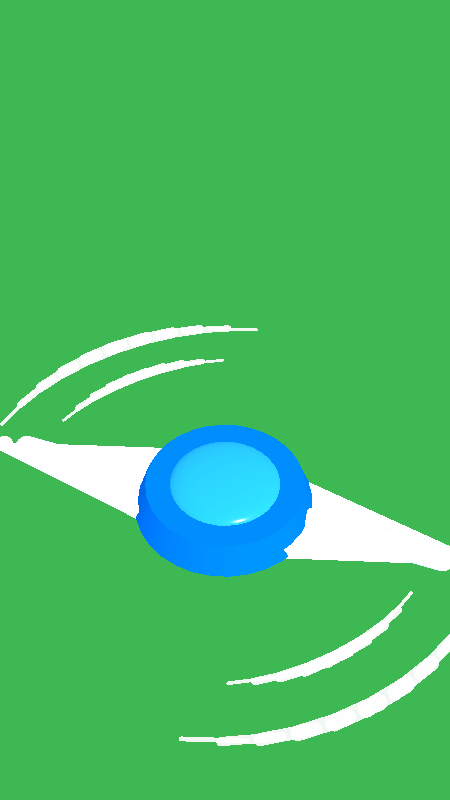

# Sistema do Cortador (Serra Circular) 🪚🤖

Este documento detalha a física, estrutura mecânica, lógica de movimentação, detecção de corte radial e comportamento de choque do cortador em **Grass Cut Bot**.

---

## 1. Estrutura do Cortador (`cutter.tscn`)

O cortador é instanciado a partir de um `CharacterBody3D` posicionado rente ao solo (`Y = 0.1m`), utilizando exclusivamente **primitivas geométricas nativas da Godot 4** para compor uma lâmina estilizada aerodinâmica com acabamento toy/arcade e rastros dinâmicos de rotação:

```
Cutter (CharacterBody3D - Layer 2, Mask 1|8)
├── BodyCollision (CollisionShape3D - Cylinder r=0.45m, h=0.25m)
├── VisualPivot (Node3D)
│   └── SawMesh (Node3D - rotação contínua em Y a 1200°/s)
│       ├── HubCenter (Node3D - Hub motor central azul)
│       │   ├── Base (MeshInstance3D - CylinderMesh r_topo=0.20m, r_base=0.23m, h=0.08m, Azul #0076F5)
│       │   └── TopDome (MeshInstance3D - SphereMesh achatada r=0.14m, h=0.075m, Azul Celeste #24B2FF)
│       ├── WingRight (Node3D - Asa direita aerodinâmica)
│       │   ├── RootBase (MeshInstance3D - BoxMesh 0.2x0.035x0.2m, Branco #F8F9FF)
│       │   ├── MainWedge (MeshInstance3D - PrismMesh aerodinâmico 0.28x0.54x0.035m, left_to_right=0.4)
│       │   ├── Spine (MeshInstance3D - CapsuleMesh espinha central r=0.032m, h=0.48m)
│       │   └── TipRound (MeshInstance3D - SphereMesh ponta suave r=0.024m)
│       ├── WingLeft (Node3D - Asa esquerda simétrica girada 180° em Y)
│       ├── SwooshRight (Node3D - Rastros de vento crescentes atrás da ponta direita)
│       │   ├── OuterSeg_1..10 (MeshInstance3D - 10 cápsulas tangentes em arco r=0.66m, unshaded alpha)
│       │   └── InnerSeg_1..8 (MeshInstance3D - 8 cápsulas tangentes em arco r=0.52m, unshaded alpha)
│       └── SwooshLeft (Node3D - Rastros de vento crescentes atrás da ponta esquerda, girado 180° em Y)
├── BladeArea (Area3D - Layer 0, Mask 4)
│   └── CollisionShape3D (Cylinder r=0.65m, h=0.4m)
└── SparkParticles (CPUParticles3D - Faíscas amarelas em impacto seco)
```



---

## 2. Parâmetros Físicos e Movimentação

| Parâmetro | Valor Base | Efeito no Jogo |
| :--- | :--- | :--- |
| `base_speed` | `6.5 m/s` | Velocidade máxima de deslocamento linear. Escalável via upgrade de Velocidade. |
| `acceleration` | `24.0 m/s²` | Rapidez com que o cortador atinge a velocidade desejada após o toque. |
| `friction` | `18.0 m/s²` | Desaceleração suave quando o jogador solta o joystick. |
| `rotation_speed`| `1200.0 °/s` | Rotação angular ininterrupta do disco da serra em torno do eixo Y. |
| `knockback_force`| `5.0 m/s` | Impulso reverso aplicado na direção normal da colisão contra obstáculos. |

### Lógica de Vetor de Movimento
O vetor 2D fornecido pelo joystick flutuante é convertido diretamente para o plano horizontal 3D ($X, Z$):
```gdscript
var move_dir = Vector3(input_direction.x, 0.0, input_direction.y)
if move_dir.length_squared() > 0.001:
    var target_vel = move_dir * target_speed
    velocity = velocity.move_toward(target_vel, acceleration * delta)
else:
    velocity = velocity.move_toward(Vector3.ZERO, friction * delta)
move_and_slide()
```

---

## 3. Mecânica de Corte Radial por Contato

- O cortador é omnidirecional: não existe dianteira ou traseira, o corte é uniforme em qualquer sentido de condução.
- A detecção é executada por um `Area3D` dedicado (`BladeArea`) com camada de colisão configurada para monitorar a vegetação (`collision_mask = 4`).
- A cada frame de física, o cortador varre as áreas sobrepostas pertencentes ao grupo `"vegetation"` e dispara `plant.cut(power)`.
- **Evolução por Upgrade:**
  - O raio da lâmina é calibrado dinamicamente: `raio = 0.65m + (nivel - 1) * 0.12m`.
  - A malha visual do disco acompanha proporcionalmente o novo diâmetro da área de colisão.

---

## 4. Estado de Choque e Ricochete (Obstáculos)

Ao colidir frontalmente contra obstáculos sólidos (como rochas do grupo `"obstacles"`):
1. **Interrupção de Inércia e Atordoamento:** O estado `is_stunned` é ativado por 0.18s, impedindo a aceitação de comandos direcionais imediatos.
2. **Impulso Reverso (Knockback):** A velocidade do cortador é redirecionada na direção normal da colisão:
   $$\vec{v}_{\text{choque}} = \vec{n}_{\text{colisão}} \times \text{knockback\_force}$$
3. **Emissão de Faíscas:** O nó `SparkParticles` é reposicionado no ponto de contato e ativado instantaneamente.
4. **Vibração Tátil e Tremer de Câmera:** O `GameManager` emite vibração seca (`Input.vibrate_handheld(60)`) e solicita um camera shake de intensidade 0.35 por 0.2s.
