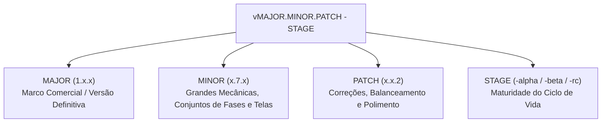
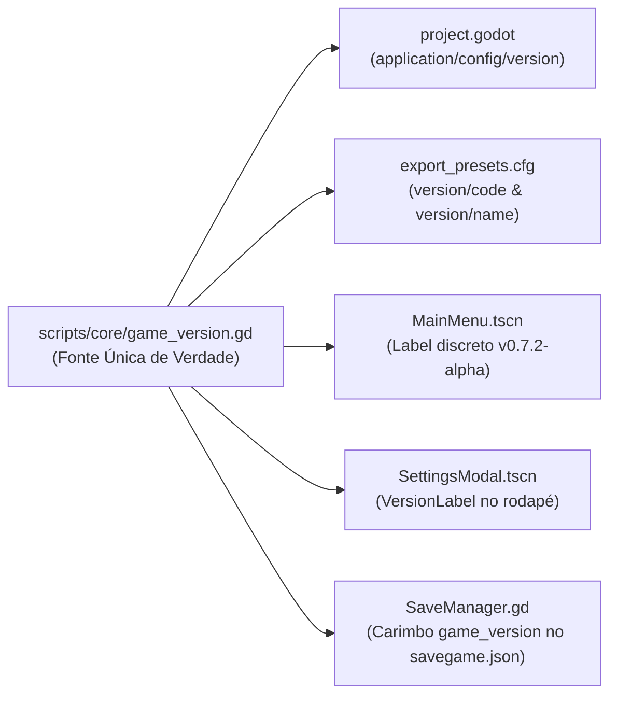

# Sistema de Versionamento e Ciclo de Lançamento 🏷️🌿

## 1. Visão Geral e Filosofia de Versionamento
O **Sistema de Versionamento do Grass Cut Bot** estabelece um padrão rigoroso e consistente para rastrear a evolução do projeto, gerenciar lançamentos para testes e jogadores mobile, proteger a persistência de dados salvos e organizar o ciclo de vida do desenvolvimento.

Inspirado no padrão consolidado do projeto irmão *Rover Raid*, adotamos o padrão **Game SemVer (Semantic Versioning adaptado para Jogos)**, alinhado ao ciclo de maturidade do produto (*Pre-Alpha $\to$ Alpha $\to$ Beta $\to$ Release Candidate $\to$ Lançamento 1.0 Gold Master*).

---

## 2. Estrutura do Padrão Game SemVer

Toda versão do Grass Cut Bot segue a sintaxe formal:

$$\text{v}[\text{MAJOR}].[\text{MINOR}].[\text{PATCH}]-[\text{STAGE}]$$

Exemplos práticos:
- `v0.1.0-pre-alpha` (MVP inicial da física de corte e grama)
- `v0.7.2-alpha` (20 fases canônicas, robô articulado com olhos LED, editor PC e savegame)
- `v0.8.0-alpha` (Grama orgânica vetorial Poisson/Clipper, oceano toon e aparas de solo)
- `v0.9.0-alpha` (Sistema de áudio e sonoplastia completo com 20 SFX e trilhas Dyalla)
- `v0.10.0-alpha` (Calibração háptica Android precisa e suíte de ícones oficiais)
- `v0.11.0-alpha` (Celebração de vitória 3 ⭐, derrota expressiva, teleporte 3D e moedas cartoon)
- `v0.12.38-alpha` (**Versão Atual:** Refinamento de Level Design das 20 fases canônicas com ícones de espécies florais no HUD, trilhas guia `island_dirt`, geometrias temáticas de grama e calibração 3 estrelas)
- `v0.13.0-beta` (*Feature Complete:* Abas Loja/Coleção integradas a moedas e balanceamento final)
- `v1.0.0-rc.1` (*Feature Freeze:* Testes finais de empacotamento APK/AAB no Android)
- `v1.0.0` (Lançamento Oficial Comercial na Google Play Store)



### Significado de Cada Segmento:

1. **MAJOR (Versão Principal - X.0.0):**
   - **0:** Jogo em desenvolvimento ativo (Pre-Alpha, Alpha ou Beta).
   - **1:** Lançamento Comercial Oficial do jogo (**Gold Master 1.0**) com todas as 20+ fases canônicas, todas as abas do Hub (Home, Garage, Collection, Store), áudio completo e suporte total Android.
   - **2+:** Grandes expansões de conteúdo pós-lançamento (ex: Novos Mundos/Biomas, Modos Desafio adicionais).

2. **MINOR (Versão Secundária / Marcos de Conteúdo - 0.X.0):**
   - Incrementado a cada **grande subsistema, conjunto de fases ou pacote visual concluído**.
   - Exemplos de incremento:
     - Adição do Hub Principal com Diorama 3D e Sistema de Abas (`v0.5.x` $\to$ `v0.6.x`).
     - Integração do conjunto de 20 Fases Canônicas e Sistema de SaveGame (`v0.6.x` $\to$ `v0.7.x`).
     - Conclusão das telas de Coleção e Loja com moedas e cosméticos (`v0.7.x` $\to$ `v0.8.x`).

3. **PATCH (Correções e Ajustes de Balanceamento - 0.0.X):**
   - Incrementado em **correções de bugs, polimento de física/shaders, ajustes de layout e balanceamento**.
   - Exemplos: calibração da velocidade da mono-wheel, ajuste no raio da lâmina (+0.10m), refinamento da margem da TopBar do HUD.

4. **STAGE (Fase do Ciclo de Vida):**
   - **`pre-alpha`**: Protótipos mecânicos e provas de conceito iniciais (*Concluído*).
   - **`alpha`**: Construção e adição ativa das mecânicas centrais do jogo (*Feature Incomplete*) — **FASE ATUAL**.
   - **`beta`**: Todas as mecânicas programadas (*Feature Complete*); foco em áudio, eliminação de bugs e testes de aparelho.
   - **`rc` (Release Candidate)**: Código congelado (*Feature Freeze*); apenas validação de builds APK/AAB para a loja.
   - **`release` / Omitido**: Versão final pública e estável.

---

## 3. As Fases do Ciclo de Desenvolvimento do Grass Cut Bot

| Fase | Faixa de Versão | Status no Projeto | Foco Principal e Critérios de Conclusão |
| :--- | :--- | :--- | :--- |
| **Pre-Alpha** | `v0.1.0` a `v0.2.x` | **Concluída** | Prova de conceito do corte por contato radial, movimento omnidirecional, shader Arnklit e ricochete com rochas. |
| **Alpha** | `v0.3.0` a `v0.8.x` | **FASE ATUAL (`v0.7.2-alpha`)** | Robô 3D com física procedural, 4 cores de grama + trigo e flores, editor de fases PC (tela cheia), 20 fases canônicas em ilhas 3D flutuantes sem cercas com autotile, Menu Hub com robô autônomo, olhos LED com 10 expressões e SaveManager resiliente. Pendente: Abas Loja/Coleção e Sistema de Áudio. |
| **Beta** | `v0.9.0` a `v0.9.x` | **Planejada** | *Feature Complete*. Conclusão das 4 abas completas do Hub, áudio dinâmico (música/SFX de corte), balanceamento da progressão de moedas e testes em múltiplos aparelhos Android. |
| **Release Candidate** | `v1.0.0-rc.X` | **Planejada** | *Feature Freeze*. Zero novos recursos; caça rigorosa a bugs impeditivos e validação final dos arquivos `.apk` e `.aab`. |
| **Gold / Lançamento 1.0** | `v1.0.0` | **Planejada** | Entrega comercial completa na Google Play Store. |

---

## 4. Arquitetura Técnica no Godot 4



### 4.1. Classe Global `GameVersion` (`scripts/core/game_version.gd`)
A classe global `GameVersion` centraliza as constantes e cálculos de versão:
- `MAJOR`, `MINOR`, `PATCH`, `STAGE`, `BUILD_TYPE`
- `get_version_string() -> String` (ex: `"v0.7.2-alpha"`)
- `get_raw_version() -> String` (ex: `"0.7.2-alpha"`)
- `get_display_name() -> String` (ex: `"Grass Cut Bot v0.7.2-alpha"`)
- `get_version_code() -> int` (ex: `702`)
- Checagens de ciclo: `is_pre_alpha()`, `is_alpha()`, `is_beta()`, `is_rc()`, `is_release()`

### 4.2. Configurações da Engine (`project.godot`)
Parametrizado nativamente sob a seção `[application]`:
```ini
[application]
config/name="Grass Cut Bot"
config/version="0.12.31-alpha"
```

### 4.3. Presets de Exportação Android (`export_presets.cfg`)
Configurado para exportação móvel consistente:
```ini
version/code=1231
version/name="0.12.31-alpha"
```

---

## 5. Exibição na Interface do Usuário (UI)

1. **Menu Principal (`main_menu.tscn`):** Um nó `VersionBadge` (`Label`) posicionado de forma limpa e discreta sob a barra superior no canto esquerdo, atualizado via `GameVersion.get_version_string()`.
2. **Modal de Configurações (`settings_modal.tscn`):** O rodapé sob o botão de suporte exibe dinamicamente:
   `"Grass Cut Bot v0.12.31-alpha • Mobile Edition"`.

---

## 6. Persistência e Proteção do SaveGame

O [`SaveManager`](./SISTEMA_DE_SAVE.md) grava os metadados de versão da build em cada salvamento:
```json
{
  "version": "1.0",
  "game_version": "v0.7.2-alpha",
  "game_version_code": 702,
  "saved_at": 1792419200
}
```
Isso garante rastreabilidade total de dados e permite futuras migrações automáticas de esquemas à medida que novas fases e cosméticos forem adicionados.

---

## 7. Ferramenta de Incremento Automatizado (`bump_version.gd`)

Para avançar a versão atomicamente:
1. Abra `res://scripts/tools/bump_version.gd` no Script Editor da Godot.
2. Pressione `Ctrl+Shift+X` (ou acerte o método estático `bump(BumpMode)`).
3. O script atualiza atomicamente:
   - `scripts/core/game_version.gd`
   - `project.godot`
   - `export_presets.cfg`
