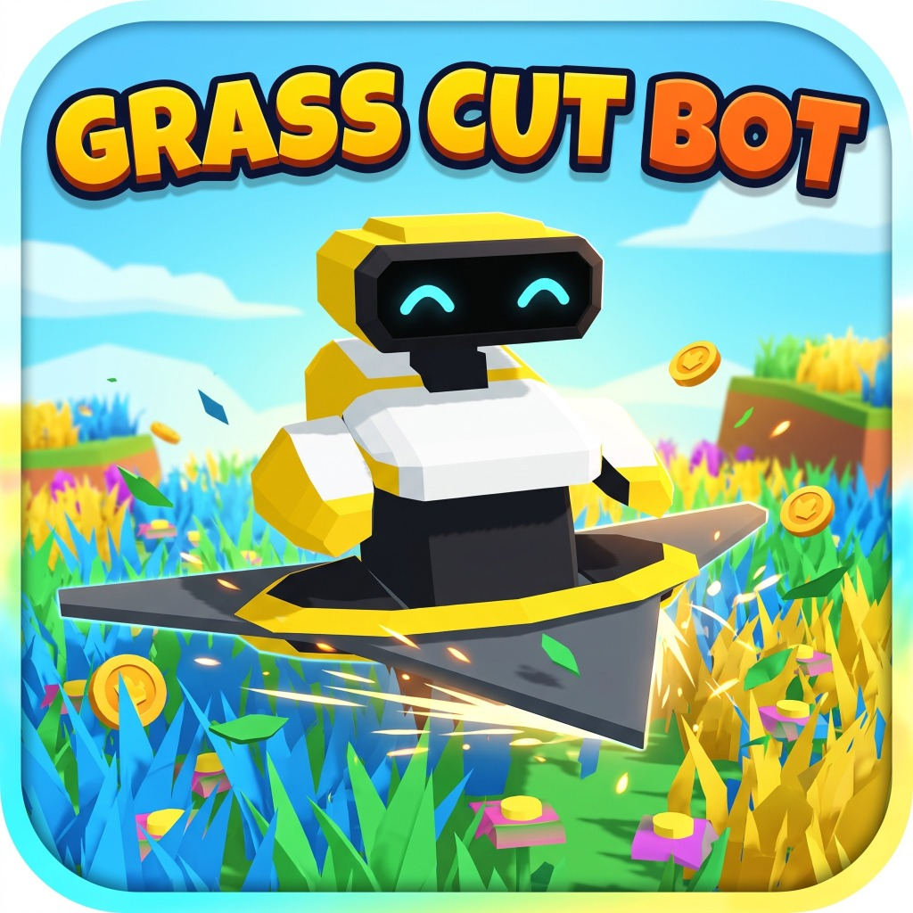

# Projeto Grass Cut Bot 🌿🤖 (Hub Central da Wiki)

## 1. Visão Geral e Filosofia do Jogo

**Grass Cut Bot** é um jogo hiper-casual e de simulação arcade com foco em relaxamento mecânico, feedback tátil responsivo (*satisfying game feel*) e partidas dinâmicas contra o relógio em formato vertical (Portrait), projetado sob medida para dispositivos móveis Android.

O jogador assume o comando do **Cutter Bit**, um robô cortador equipado com uma serra circular omnidirecional em perspectiva isométrica. Seu objetivo é limpar gramados compactos em ilhas 3D flutuantes no oceano, cumprir metas específicas de colheita vegetal (grama comum, trigo dourado resistente e flores raras) antes do cronômetro zerar, desviando de rochas e barreiras sólidas.

O núcleo do jogo combina:
1. **Sensação Tátil Suculenta (Juicy Game Feel):** Vibração háptica leve e contínua sincronizada com cada tufo ceifado, partículas de folhas fatiadas em arco parabólico, números cartoon 3D flutuantes (`+1`, `+3`, `+5`) com rastro e resposta ágil de corte radial imediato.
2. **Controle com Uma Mão (One-Thumb Play):** Joystick flutuante que surge em qualquer toque na metade inferior da tela, garantindo navegação natural sem fadiga motora.
3. **Loop de Metas e Recompensas:** Contadores de colheita no HUD que decrescem em tempo real e moedas verdes acumuladas para evoluir a máquina na Oficina de Upgrades (Raio, Potência, Velocidade e Multiplicador), desbloqueando 4 patamares visuais de lâminas estreladas.
4. **Ilhas 3D Flutuantes Sem Cercas:** Cenários abertos sobre oceano azul turquesa toon com contenção invisível na borda costeira, integrados ao carregador dinâmico de níveis em JSON v3.

*Figura: Concept Art canônico do robô cortador Cutter Bit com vistas em perspectiva, anatomia mecânica, monociclo e expressões faciais de LED.*

---

## 📚 Índice Mestre da Documentação Técnica (Os 5 Pilares)

A documentação técnica, artística e de engenharia de **Grass Cut Bot** está estruturada em 5 Pilares Temáticos interconectados, além do Hub, do Catálogo Histórico e do Roadmap:

### 🏛️ Pilar 1: Visão Geral, Design e Direção de Arte
1. **[GDD Oficial - Documento Vivo (v0.12-alpha)](./01_visao_geral_e_gdd/GDD_OFICIAL.md)**  
   O Game Design Document canônico: High Concept, USP, Core Loop, esquema de entrada, especificações do cortador, regra de lote de colheita, tipos de vegetação e estrutura dos estágios.
2. **[Direção de Arte e Estilo Visual](./01_visao_geral_e_gdd/DIRECAO_DE_ARTE_E_VISUAL.md)**  
   Identidade visual Low Poly com acabamento fosco (*matte*), paleta de cores sólidas vibrantes (7 cores cosméticas de grama, trigo e flores), iluminação suave, sombreamento de ilhas, shader Toon Water e efeitos de partículas.

---

### 🪚 Pilar 2: Entidades, Física e Mecânicas de Jogo
3. **[Sistema do Cortador (Serra Circular)](./02_entidades_e_mecanicas/SISTEMA_DO_CORTADOR.md)**  
   Estrutura mecânica da lâmina rotativa (1200°/s), corte por contato radial omnidirecional, inércia responsiva, suspensão procedural acoplada ao chassi, parâmetros globais de shader e sistema de choque/knockback contra obstáculos sólidos.
4. **[Sistema de Vegetação e Colheita](./02_entidades_e_mecanicas/SISTEMA_DE_VEGETACAO.md)**  
   Campos vetoriais 2D via Clipper C++, amostragem Poisson Disk, renderização via `MultiMeshInstance3D`, variedades vegetais, regra de lote de colheita (10 tufos = 1 meta), aparas fatiadas no solo e ciclo de vida dos tufos.
5. **[Sistema de Obstáculos e Terreno da Ilha](./02_entidades_e_mecanicas/SISTEMA_DE_OBSTACULOS_E_TERRENO.md)**  
   Kit de blocos 3D de ilha sem paredes internas no Blender 5.2, oceano turquesa toon com espuma costeira 2D animada (`CoastalFoamRibbon`), contenção invisível na borda (Layer 1) e rochas sólidas causadoras de ricochete e faíscas.

---

### 🗺️ Pilar 3: Level Design e Estrutura de Fases
6. **[Estrutura das Fases e Level Design](./03_level_design_e_fases/ESTRUTURA_DAS_FASES.md)**  
   Catálogo canônico das 20 fases em ilhas 3D flutuantes com geometrias únicas, progressão em 5 Tiers de maestria, introdução de trigo e flores, caminhos estreitos, labirintos rochosos e transição triunfal para o Ciclo Mestre.
7. **[Sistema do Editor de Fases In-Game para PC](./03_level_design_e_fases/SISTEMA_EDITOR_DE_FASES.md)**  
   Editor fullscreen em janela widescreen no PC (F2/F6), kit de tiles 3D com Auto-Tile, pincel livre com Clipper C++, carimbos analíticos de 1x a 20x, cards de metas customizadas (CheckBox e SpinBox), prancheta vetorial plana e playtest instantâneo com F1.

---

### 🎮 Pilar 4: Sistemas, Interface, Controles, Áudio e Metagame
8. **[Sistema de Controles Touch (Joystick Flutuante)](./04_sistemas_e_gameplay/SISTEMA_DE_CONTROLES_TOUCH.md)**  
   Lógica do joystick flutuante ancorado na metade inferior da tela, cálculo do vetor de arrasto, zona morta contra microtoques e suporte transparente para mouse e teclado no PC.
9. **[Sistema de Interface, HUD e Menus](./04_sistemas_e_gameplay/SISTEMA_DE_INTERFACE_HUD.md)**  
   Menu Inicial (Hub Principal) com Câmera Dual (Bot heróico e Mapa do Arquipélago com drag scroll), 4 abas inferiores (Garage, Home, Collection, Store), Modal de Configurações, Top HUD dinâmico e modais de Pausa, Vitória (estrelas em arco e bottom bar) e Derrota expressiva.
10. **[Economia e Oficina de Upgrades](./04_sistemas_e_gameplay/ECONOMIA_E_OFICINA.md)**  
    Moedas verdes por lote ceifado, números flutuantes 3D cartoon com rastro (*number trail*), progressão dos 4 atributos centrais da oficina (Raio, Potência, Velocidade e Multiplicador) e evolução dos 4 Tiers de lâminas estreladas.
11. **[Game Feel, Haptics e Câmera Isométrica](./04_sistemas_e_gameplay/GAME_FEEL_E_HAPTICS.md)**  
    Pilares do relaxamento mecânico, vibrações táteis sincronizadas (pulso no corte e impacto seco no obstáculo com rate-limit), câmera isométrica suave com interpolação pura XZ, camera shake translacional e transição cinematográfica de vitória.
12. **[Sistema de Áudio e Sonoplastia](./04_sistemas_e_gameplay/SISTEMA_DE_AUDIO_E_SFX.md)**  
    Barramentos nativos Master/Music/SFX, trilhas suaves de Dyalla para Menu e Gameplay, motor elétrico modulado proceduralmente por velocidade, pool de SFX e debounce contra machine-gun effect.

---

### ⚙️ Pilar 5: Engenharia de Software, Performance e Desenvolvimento
13. **[Arquitetura do Projeto Godot 4](./05_arquitetura_e_desenvolvimento/ARQUITETURA_DO_PROJETO.md)**  
    Organização modular de diretórios por domínio, convenção das camadas físicas (Layers 1 a 4) e Autoloads globais (`SaveManager`, `AudioManager`, `GameManager`, `UpgradeManager`).
14. **[Padrão de Scripts e Boas Práticas GDScript 4](./05_arquitetura_e_desenvolvimento/PADRAO_DE_SCRIPTS.md)**  
    Regras estritas de Zero Warnings, tipagem estática obrigatória, desacoplamento por sinais e prevenção de erros comuns de runtime.
15. **[Plano Mestre de Otimização e Performance](./05_arquitetura_e_desenvolvimento/PLANO_MESTRE_DE_PERFORMANCE.md)**  
    Roteiro completo de otimização de CPU/GPU para 60 FPS estáveis em mobile: cache de obstáculos, SubViewport dirty sob demanda, uniforms globais de shader, desacoplamento de depth texture na água e scaling 3D/FSR.
16. **[Portabilidade e Otimização para Android](./05_arquitetura_e_desenvolvimento/PORTABILIDADE_ANDROID.md)**  
    Parâmetros do preset de exportação Android, renderizador Mobile (Vulkan), permissão de vibração, safe zone de ícones adaptativos e renderização portrait.
17. **[Sistema de SaveGame e Persistência de Dados](./05_arquitetura_e_desenvolvimento/SISTEMA_DE_SAVE.md)**  
    Persistência atômica e resiliente em `user://savegame.json`, backup `.bak` anti-corrupção, avaliação de 1 a 3 estrelas (⭐), auto-save em eventos críticos e reset de progresso.
18. **[Sistema de Versionamento e Ciclo de Lançamento](./05_arquitetura_e_desenvolvimento/SISTEMA_DE_VERSIONAMENTO.md)**  
    Padrão Game SemVer (`v0.12.31-alpha`), classe global `GameVersion`, sincronização em `project.godot` e `export_presets.cfg`, e script de automação `bump_version.gd`.
19. **[Diretrizes de Desenvolvimento, Terminal e Git](./05_arquitetura_e_desenvolvimento/DIRETRIZES_DE_DESENVOLVIMENTO.md)**  
    Padrões para PowerShell no Windows, codificação UTF-8 sem BOM, pipeline glTF Blender com export_apply e commits semânticos com push obrigatório no GitHub.

---

## 📜 Registro Histórico Perpétuo de Melhorias

Para consultar o histórico detalhado de todas as refatorações, construções e entregas técnicas do projeto, acesse:  
👉 **[Catálogo Mestre do Histórico de Melhorias (`INDICE_MELHORIAS.md`)](./historico_melhorias/INDICE_MELHORIAS.md)**
- Consulte também a [Regra do Histórico Perpétuo](./historico_melhorias/regra_historico_melhorias.md).

---

## 🎯 Planejamento e Roadmap

Para acompanhar as próximas etapas de desenvolvimento ordenadas por impacto na experiência do jogador (incluindo o modo construtor mobile "Bot Arquiteto"), consulte o **[Roadmap de Melhorias Futuras](./MELHORIAS_FUTURAS.md)**.
